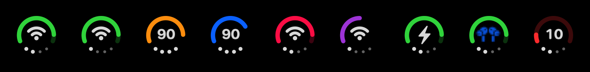
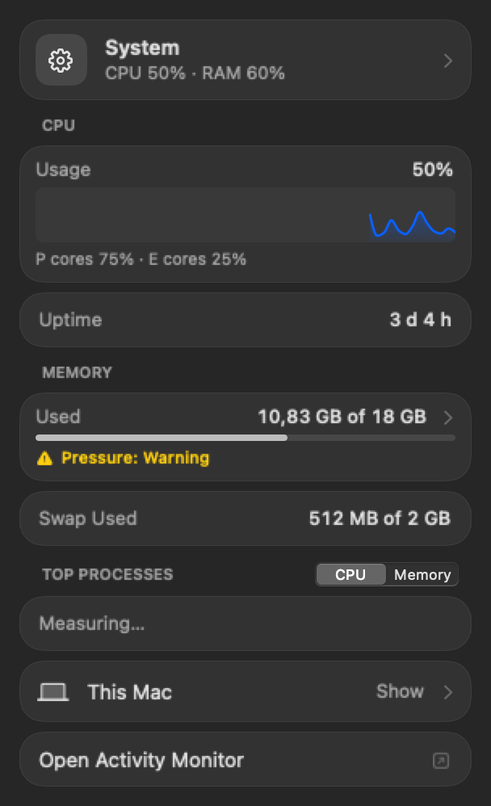
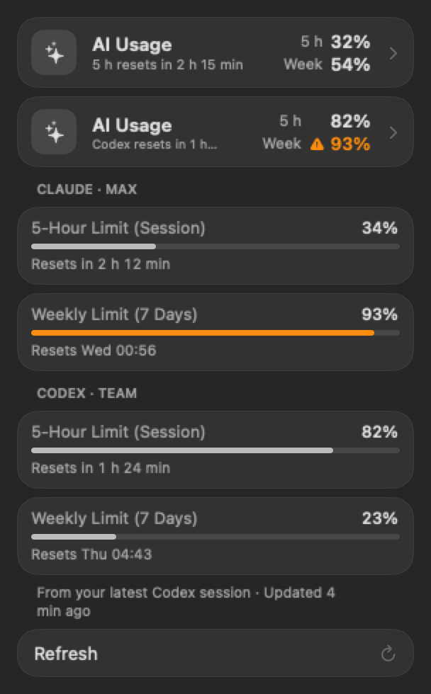
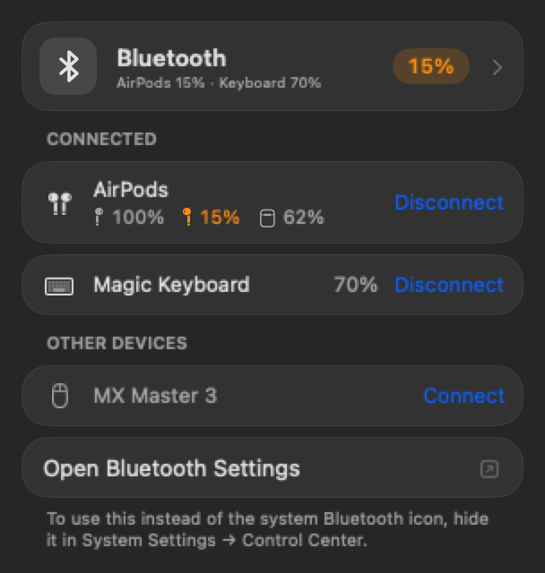
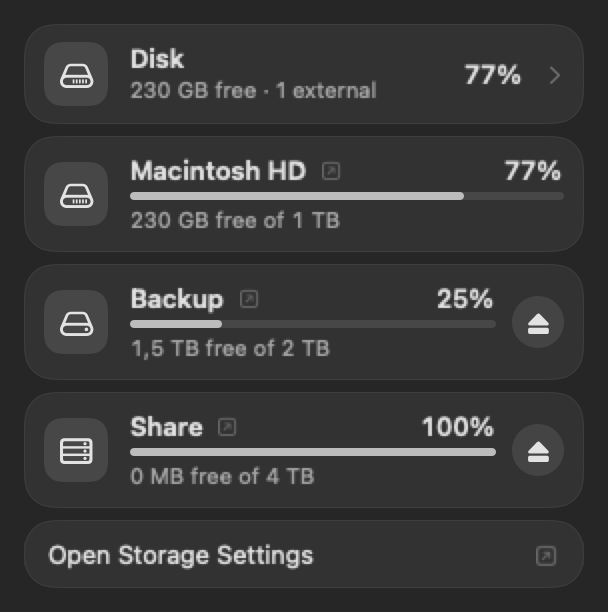

<div align="center">

<picture>
  <source media="(prefers-color-scheme: dark)" srcset="docs/images/huglab-logo-on-dark.png">
  
</picture>

# DuoBar+

Battery, network and volume in one menu bar icon, with a detail page for everything behind them.

[**Download**](https://github.com/huglab-dev/DuoBar-Plus/releases/latest) · macOS 13 or later · Apple Silicon and Intel · MIT License

<br>



</div>

DuoBar+ is a fork of [DuoBar](https://github.com/Mikeli7666/DuoBar) by Mike Li. DuoBar puts a battery ring, the network state and four volume dots into a single icon. DuoBar+ keeps that idea, lets you choose what each part of the icon shows, and adds a detail page per module to the popover.

## The menu bar icon

Each part of the icon can show something else:

| Part | Options |
|---|---|
| Ring | Automatic, Battery, CPU, Memory, Disk, None |
| Center | Wi-Fi, Battery %, CPU %, None |
| Dots | Volume, Network, Battery, Wi-Fi Signal, CPU, None |

You can also set the ring color (any color you like), the icon size, the ring thickness and the size of the center mark. The battery percentage goes inside the icon or next to it.

The icon reacts to events, and each one can be turned off: plugging in, connecting AirPods or headphones, low battery, losing the network, and changing the volume. With **Unfold on Hover**, pointing at the icon opens it into one icon per reading, and clicking one goes straight to its page.

## The popover

Modules can be reordered and switched off in Settings. A module that is off runs no timers and asks for no permissions.

| Module | What it shows |
|---|---|
| **Network** | Signal, noise, link rate, channel, security and Wi-Fi standard. IP addresses, router, DNS and VPN. Hardware and private MAC addresses. A speed graph, a Wi-Fi picker that lists known networks first, and an optional roaming log. |
| **Battery** | Level, charger, cycle count and maximum capacity. |
| **Bluetooth** | Paired devices with connect and disconnect. Battery levels, including left, right and case for AirPods. |
| **System** | A live CPU graph with performance and efficiency cores, memory breakdown and pressure, swap, top processes and details about the Mac. |
| **Disk** | All volumes. Click one to open it in Finder, or unmount external drives from the list. |
| **AI Usage** | 5-hour and weekly limits for Claude and Codex, with reset times and a warning from 90 %. Off by default. |

<table>
  <tr>
    <td></td>
    <td></td>
  </tr>
  <tr>
    <td></td>
    <td></td>
  </tr>
</table>

<sub>Screenshots are rendered with sample data.</sub>

## Install

Download the latest `.dmg` from [Releases](https://github.com/huglab-dev/DuoBar-Plus/releases), open it and drag DuoBar+ to Applications.

DuoBar+ is signed with a self-signed certificate and is not notarized by Apple, so macOS blocks it the first time you open it. To allow it:

1. Try to open DuoBar+ and close the warning.
2. Open **System Settings → Privacy & Security** and scroll to **Security**.
3. Choose **Open Anyway** next to DuoBar+ and confirm with your password.

New versions need the same approval. The app shows a card in the popover when a new version is out, with a link to its download page. It does not install anything itself. You can turn the check off in Settings.

## Build from source

Building needs Xcode 26, because the Liquid Glass code uses the macOS 26 SDK. From a clone of this repository:

```bash
xcodebuild -project DuoBar.xcodeproj -scheme DuoBar -configuration Release -derivedDataPath build build
```

```bash
open "build/Build/Products/Release/DuoBar+.app"
```

The build is signed ad hoc, so macOS may ask for permissions again after each rebuild. If the Bluetooth list is empty, the app tells you when access is missing and links to the right setting. To sign with your own Apple Developer team, set `DEVELOPMENT_TEAM` in the project.

Run the tests with:

```bash
xcodebuild -project DuoBar.xcodeproj -scheme DuoBar -destination 'platform=macOS' test
```

## Privacy

DuoBar+ has no analytics and no account. It makes two kinds of network request:

- When the popover opens, at most once a day, it asks GitHub for the latest release of DuoBar+. Turn this off under Settings → General → Updates.
- If you turn on AI Usage and leave Claude enabled, it fetches your plan limits from Anthropic.

| Access | Why |
|---|---|
| Location | macOS requires it to reveal the name of the Wi-Fi network. |
| Bluetooth | To list devices and recognize audio connections. |
| Keychain (only with AI Usage and Claude on) | To read the sign-in Claude Code already saved. |

AI Usage reads the Claude Code sign-in but never renews or changes it. The request goes to `api.anthropic.com` while the popover is open, at most every two minutes unless you press Refresh. That endpoint is undocumented, so it can stop working without notice. Codex limits come from the session logs Codex saves on your Mac, and nothing about them is sent anywhere.

## Performance

With the popover closed and no CPU, memory, disk or network reading in the icon, DuoBar+ used 0.10 % of one CPU core over five minutes, against 0.13 % for DuoBar 1.4.0 measured at the same time. Readings like CPU in the icon cost about 1.5 %. The method and the other measurements are in [docs/PERFORMANCE.md](docs/PERFORMANCE.md).

## Credits and license

DuoBar+ is developed by Hugo Bjurström at huglab.

It is based on [DuoBar](https://github.com/Mikeli7666/DuoBar), Copyright (c) 2026 Mike Li, and is distributed under the [MIT License](LICENSE). The license text is also included in the app, under Settings → General → Developer.

DuoBar+ is an independent project and is not affiliated with or endorsed by Apple, Anthropic or OpenAI, or by the original DuoBar project.
